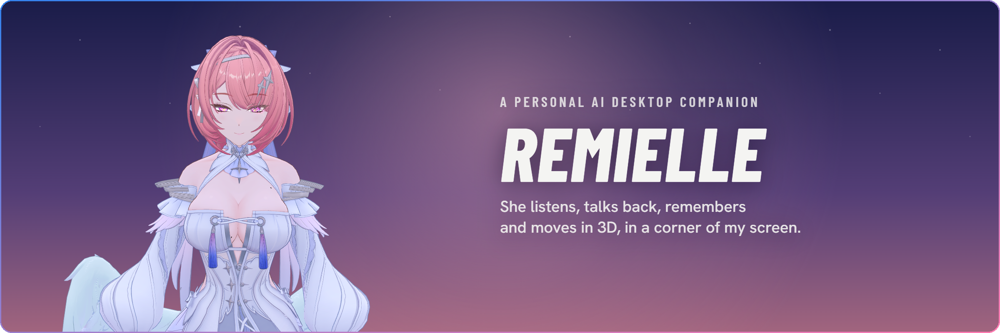
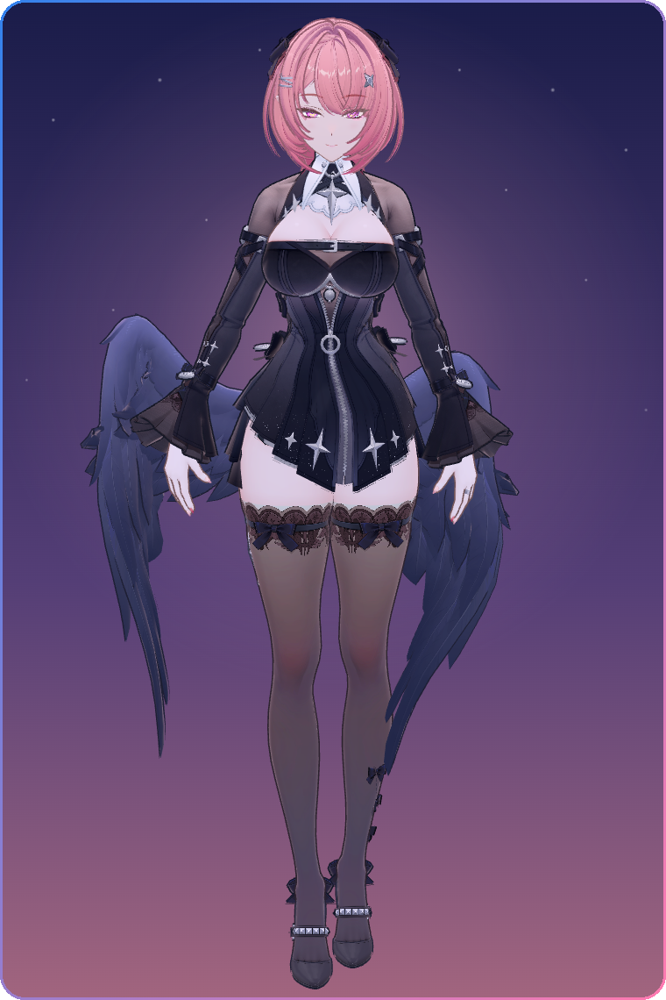
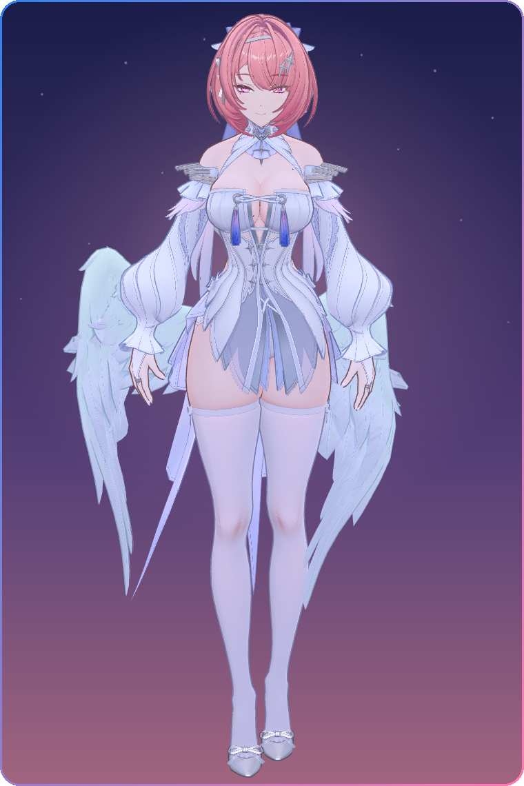
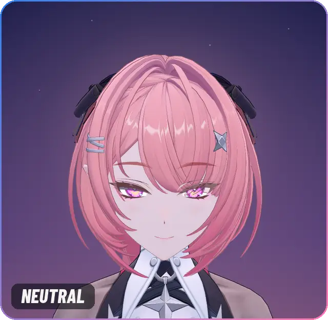
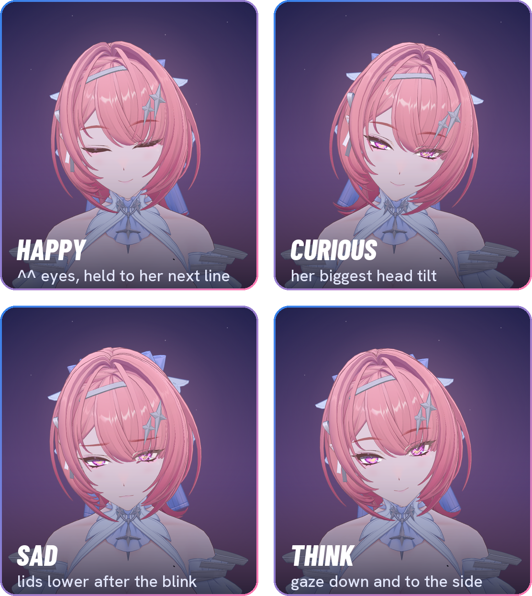
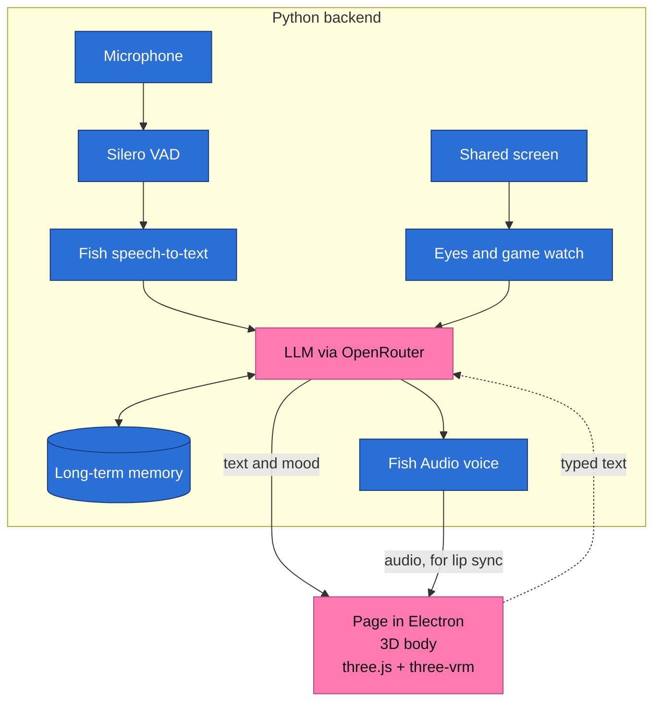

<h1>Project Remielle</h1>

<b>Microphone → speech-to-text → streaming LLM → text-to-speech → 3D character, in real time.</b> Built in Python and JavaScript, with automated tests.

A personal AI companion modeled on Remielle Dan from <i>Zenless Zone Zero</i>, built step by step as a learning project to understand how an AI app is put together. I design it and test every feature myself; AI coding agents (Claude Code) write much of the code.

Made by Thinh Nguyen, a finance student at Rutgers (class of 2029) aiming for fintech, financial systems and FP&A roles. <a href="#about-me">About me ↓</a>

 

 

> [!NOTE]
> This is a showcase. The source code is private: it's a personal project I don't want others to run or reuse, and it is built around her persona, her memory of me and a 3D model whose license doesn't allow sharing. This repo has a demo, screenshots, the architecture and [a few code samples](#code-samples). It is for viewing only (see the [LICENSE](LICENSE) and [What is not in this repo](#what-is-not-in-this-repo)).

## See her

  
  &nbsp;
  

Her black and white outfits, rendered live in the app's 3D view (three.js + three-vrm) on its own dusk sky.

<b>Acting, measured from footage</b> <i>Still being tuned (see the <a href="#where-its-going">roadmap</a>).</i>

  

Recorded from the app's own page by a script that steps the real animation code frame by frame through a scripted sequence of moods, saved at 30 fps. The mouth is the app's lip-sync test, so there is no sound.

She laughs with ^^ eyes, startles, then tilts her head, curious. The label in the corner names the mood of each line.

Her timing isn't guessed. AI agents I direct track her face and head in Zenless Zone Zero footage frame by frame with Python scripts, and her animation is fitted to those numbers. My rule is that every new version is compared with the footage side by side and reviewed before I test it. The ^^ closes over about 8 frames. A startle peaks 8 frames in, and its wide eyes last only 2 frames. Her head moves settle along a curve fitted to the footage. The footage is never shared; only the numbers are in the code.

<b>Four of her moods, and the numbers behind her acting</b>

  

Four of her nine moods, each as the face of a new line. Her hands stay down in these shots: the poses where her hands touch her face and chest are still being solved (roadmap, Next 5).

| What was measured | The number | In the code |
|---|---|---|
| Her face lands before her voice | 0.20 s (6 frames) | `FACE_LEAD` |
| An ordinary head move | starts at frame 4, half done at 10.9, 90% at 18.6 | `SETTLE`, `moveShape()` |
| A startle | peaks at 2.2× the move at frame 8, settled by frame 18 | `popBump()` |
| Surprise on her face | at most 0.25 strength, for only 2 frames | `ZZZ_MOODS.surprised` |
| Her closed-eye smile (^^) | half shut at frame 4.1, shut by about frame 8 | `setZzzEmotion()` |
| A blink | 0.233 s | `BLINK_CURVE` |
| Where she looks | changes inside a blink (in a fluster, under a squint), settled 15 to 29 frames in | `setGaze()` |
| Her idle | one exact 4 s loop, two 2 s sways from the hips | `IDLE_EXACT` |

Frames are 30 per second. Most of these are in the sample [`motion_primitives.js`](samples/motion_primitives.js); the rest of the animation code is private. The animation tests check these rules (see [Tests](#tests)).

## What's built

<table>
  <tr>
    <td width="50%" valign="top"><b>🧠 Brain</b> An LLM through OpenRouter. Replies stream in; the first sentence is voiced while the rest is still being written. History is trimmed and the persona is cached to keep each turn cheap. Sample: <a href="samples/streaming.py"><code>streaming.py</code></a> · <a href="samples/reply_pipeline.py"><code>reply_pipeline.py</code></a></td>
    <td width="50%" valign="top"><b>🗣️ Voice</b> Fish Audio text-to-speech. Her pace and a little sound before she speaks follow her mood. Made-up lore names are pronounced with phoneme tags.</td>
  </tr>
  <tr>
    <td width="50%" valign="top"><b>👂 Ears</b> Microphone, Silero VAD and Fish speech-to-text. Hands-free by default. Sample: <a href="samples/voice_activity.py"><code>voice_activity.py</code></a></td>
    <td width="50%" valign="top"><b>🤫 Talking over her</b> If I talk while she speaks she whispers, and she only stops for real words. Sample: <a href="samples/reply_pipeline.py"><code>reply_pipeline.py</code></a></td>
  </tr>
  <tr>
    <td width="50%" valign="top"><b>🎧 Active listening</b> While I talk to her she leans in, nods, shows a soft face and makes small sounds.</td>
    <td width="50%" valign="top"><b>💾 Memory</b> Long-term facts and session summaries, updated in the background.</td>
  </tr>
  <tr>
    <td width="50%" valign="top"><b>💬 She speaks first</b> A greeting when she starts, check-ins after a quiet while, a welcome-back when I return to the PC.</td>
    <td width="50%" valign="top"><b>👀 Eyes</b> Looks at a window or screen I share.</td>
  </tr>
  <tr>
    <td width="50%" valign="top"><b>🎮 Game reactions</b> Notices wins, defeats and fights while I play and says one short line.</td>
    <td width="50%" valign="top"><b>🧍 Body</b> A VRM model in three.js and three-vrm: lip sync, blinking, eye contact, moods, life moments. Sample: <a href="samples/motion_primitives.js"><code>motion_primitives.js</code></a></td>
  </tr>
  <tr>
    <td width="50%" valign="top"><b>🪟 Desktop window</b> Electron: frameless, transparent, always on top, click-through, in the corner of the screen.</td>
    <td width="50%" valign="top"><b>🎭 Dialogue acting</b> Her faces, head moves and timing in conversation, measured from Zenless Zone Zero footage instead of guessed, and checked by Node tests. <i>Still being tuned.</i> Sample: <a href="samples/motion_primitives.js"><code>motion_primitives.js</code></a> · <a href="samples/tests"><code>tests/</code></a></td>
  </tr>
</table>

Linked files are in <a href="samples/"><code>samples/</code></a>. The rest of the code is private.

<a href="#readme-top">back to top ↑</a>

## How it fits together

The Python backend and the 3D page talk over a local WebSocket: JSON messages for text and moods, and binary frames for her voice. Besides what I type, the page sends the mic button and the windows I pick to share. Screen pictures are taken in Python; the page never sends them. The bridge is in the sample [`websocket_bridge.py`](samples/websocket_bridge.py).

## Code samples

The source is private, so [`samples/`](samples/) has a few hand-picked files and excerpts from it, for reading only. They are not the whole app and do not run on their own. [`samples/README.md`](samples/README.md) explains each one and how to read the comments. Start with [`streaming.py`](samples/streaming.py): it's the whole file, 78 lines.

- [`streaming.py`](samples/streaming.py): streaming an LLM reply and cutting off the first full sentence, so her voice starts before the reply is finished.
- [`reply_pipeline.py`](samples/reply_pipeline.py): concurrency, with one reply written, voiced and played at the same time on three threads, and a clean stop when I talk over her.
- [`voice_activity.py`](samples/voice_activity.py): real-time audio, deciding from the microphone when I start talking, pause and stop.
- [`websocket_bridge.py`](samples/websocket_bridge.py): a WebSocket message protocol between Python and the 3D page, with thread-safe shared state and an origin check.
- [`motion_primitives.js`](samples/motion_primitives.js): 3D animation in JavaScript, with a spring, curves fitted to measured timings and the blink curve.
- [`tests/`](samples/tests/): a small Node test harness that runs the browser animation code headless, and a few of the animation tests.

<a href="#readme-top">back to top ↑</a>

## Tests

There are two test suites.

- **Animation tests** (21 Node tests): a small harness runs the browser animation code headless with a fake 3D model. Each test steps her frame by frame and checks her timing against the numbers measured from footage: when the ^^ closes, how high a startle peaks and how a head move settles. The harness and 6 of the tests are in [`samples/tests/`](samples/tests/).
- **Character tests**: 23 moments replayed against her real brain with a made-up memory and a made-up game screen. Her rules are checked automatically, and a small model (Haiku) scores each reply. A run costs about $0.10.

## What is not in this repo

- The full source code.
- Her persona and prompts.
- Her memory.
- API keys.
- The 3D model: 杏子酱Kyouko's fan edit of HoYoverse's official model. It is not included here and is never shared.

Every picture of her on this page is rendered by the app from my local copy of her model. None of them are game footage or game screenshots.

## Where it's going

Current work: making her dialogue acting match Zenless Zone Zero, measured from game footage.

**Now**

1. Acting fixes, round 2: surprise and fluster are built and wait for an independent review.
2. Arm moves that ease in and out like the footage, with blinks covering them so nothing pops.
3. Cutting build costs: routine animation work moves to free AI models, a stronger free model reviews each task, and Claude Code checks the result last.

**Next**

4. Dialogue blinks, a new face on every line, and a test of every mood-to-mood transition.
5. Contact hand poses solved in Blender so her hands meet her face and chest correctly.
6. Outfit fixes (skirt springs, sleeve cuffs) and a wing mesh fix.
7. Her idle stance.
8. Switching outfits at runtime.

<b>Done so far (8)</b>

- Brain: a streaming LLM with her persona.
- Voice that follows her mood.
- Ears: talking over her and active listening.
- Long-term memory and speaking first.
- Eyes: shared screen and game reactions.
- 3D body and Electron desktop window.
- ZZZ-accurate dialogue acting, v1.
- Acting fixes v2, part 1: test harness, idle, happy, sad.

<a href="#readme-top">back to top ↑</a>

## Lessons so far

- **Whisper, don't pause.** Pausing her on every sound felt like buffering, so she whispers instead of stopping.
- **Compare in averages.** Fish's emotion tags made no steady difference over several takes each; speaking speed and sound tags do. Compare takes in averages, never one against one.
- **Phoneme tags for made-up names.** Fish makes up pronunciations for invented names; phoneme tags fix it, plain respellings get spelled out.
- **Small memory, whole memory.** At this size, every remembered fact in the prompt beats retrieval.
- **Hidden pages don't animate.** A hidden browser page or Electron window renders no frames, so time-based checks need frames driven by hand.

## About me

I'm Thinh Nguyen, a finance student at Rutgers University (class of 2029) and an accounting analyst intern, and I build my own software in Python and JavaScript. I'm aiming for fintech, financial systems and FP&A roles, where knowing both the accounting and the code helps.

📊 At work I process vendor invoices in Microsoft Dynamics 365. My first project there: a daily duplicate-invoice check in Excel Power Query that flags invoices at risk of being paid twice. I wrote the rules, Claude (AI) wrote the queries and the dashboard, and I set it up and run it every day.

Remielle isn't a finance tool, but it taught me how APIs, real-time data and automated testing fit together. I set the design, direct AI coding agents (Claude Code) to write much of the code, and test each feature myself.

💼 Open to summer 2027 internships and part-time roles: fintech, financial systems, FP&A, financial analysis

A fan project, not affiliated with HoYoverse. Zenless Zone Zero and Remielle Dan belong to HoYoverse. The 3D model is 杏子酱Kyouko's fan edit of HoYoverse's official model. It is not included here and is never shared; only renders of it appear on this page.

  

<picture>
  <source media="(prefers-color-scheme: dark)" srcset="https://capsule-render.vercel.app/api?type=waving&color=0:0d1117%2C45:1b3a78%2C75:3382ed%2C100:ff7ab0&height=140&section=footer&reversal=true&animation=twinkling">
  
</picture>

